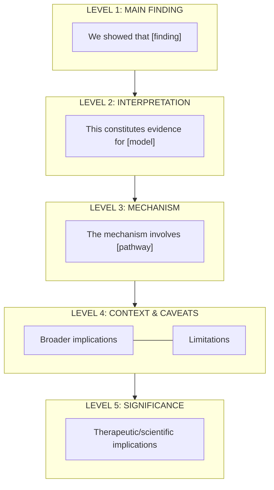

# Discussion Analysis & Construction Framework

## Purpose

This framework provides TWO capabilities:
1. **EVALUATION**: Analyze existing Discussion quality given Title + Abstract + Results.
2. **PRESCRIPTION**: Derive what a Discussion should contain when given Title + Abstract + Results.

**Core Philosophy:** The Discussion is NOT a summary of Results. It is an **INTERPRETATION** that contextualizes findings, resolves paradoxes, establishes mechanisms, and defines field significance.

---

## Rhetorical Move Analysis for Discussions

### The Four Macro-Moves

| Move | Purpose | Typical Location | Signal Words |
|------|---------|------------------|--------------|
| **MOVE 1: Interpret Results** | State finding + claim significance | Component 1 | "We showed," "This constitutes evidence for," "Our findings demonstrate" |
| **MOVE 2: Explain Mechanism** | Bridge observation to mechanism | Component 2 | "Our work casts X as," "This mechanism requires," "Unlike previous work" |
| **MOVE 3: Contextualize & Limit** | Connect to broader biology + acknowledge constraints | Component 3 | "These findings may explain," "We cannot rule out," "It remains unclear" |
| **MOVE 4: Project Significance** | State implications and future | Component 4 | "Our findings cast X as promising," "This highlights," "Future work should" |

### Sentence-Level Function Taxonomy for Discussions

| Function | Description | Example Markers |
|----------|-------------|-----------------|
| **Restatement** | Echo main finding from Results | "We showed that," "Our data demonstrate" |
| **Interpretation** | Assign meaning beyond data | "This suggests," "This constitutes evidence for" |
| **Contrastive Positioning** | Differentiate from prior work | "Unlike," "In contrast to," "Distinct from" |
| **Mechanistic Claim** | Explain HOW | "The mechanism appears to require," "X drives Y by" |
| **Contextual Bridge** | Connect to human/broader biology | "This may explain the clinical observation that" |
| **Caveat/Limitation** | Acknowledge constraints | "We cannot rule out," "It remains unclear whether" |
| **Implication** | State therapeutic/scientific significance | "This highlights the potential of," "Our findings cast X as" |
| **Future Direction** | Point to next questions | "Future work should address," "It will be important to determine" |

### Transition Word Taxonomy for Discussions

| Transition | Rhetorical Purpose | Example Usage |
|------------|-------------------|---------------|
| **"We showed/demonstrated"** | Restatement anchor | Opens interpretation paragraph |
| **"This constitutes evidence for"** | Model support claim | Links data to theoretical framework |
| **"Unlike/In contrast to"** | Differentiation | Distinguishes from prior work |
| **"Our work casts X as"** | Mechanistic claim | Assigns causal role |
| **"These findings may explain"** | Contextual bridge | Connects to human disease/biology |
| **"However/It remains unclear"** | Caveat marker | Introduces limitations |
| **"Thus/Therefore"** | Logical conclusion | Leads to significance statement |
| **"Future work should"** | Direction setter | Closes discussion with next steps |

---

## Dialectical Pattern Recognition in Discussions

Discussions often follow an **expansion-contraction pattern** (opposite of Introduction's funnel):

### The Hourglass Structure (Discussion Mirrors Introduction)

```
INTRODUCTION (Funnel: Broad → Narrow → Gap → Contribution)
                    ╲
                     ╲
                      ↘ RESULTS (Data)
                      ↙
                     ╱
                    ╱
DISCUSSION (Inverted Funnel: Specific Finding → Mechanism → Broad Implications)
```

### Discussion Flow Patterns

**Pattern 1: Resolution-Expansion**
```
┌─────────────────────────────────────────────────────────────────┐
│  SPECIFIC FINDING: "We showed X"                                 │
│  ► Direct statement of discovery                                │
└─────────────────────────────────────────────────────────────────┘
                                │
                                ▼
┌─────────────────────────────────────────────────────────────────┐
│  INTERPRETATION: "This constitutes evidence for Model Y"         │
│  ► Meaning assigned to finding                                  │
└─────────────────────────────────────────────────────────────────┘
                                │
                                ▼
┌─────────────────────────────────────────────────────────────────┐
│  MECHANISM: "The pathway involves Z"                             │
│  ► How it works + differentiation from others                   │
└─────────────────────────────────────────────────────────────────┘
                                │
                                ▼
┌─────────────────────────────────────────────────────────────────┐
│  BROADER CONTEXT: "This may explain human condition W"           │
│  ► Connection to clinical/evolutionary significance             │
└─────────────────────────────────────────────────────────────────┘
                                │
                                ▼
┌─────────────────────────────────────────────────────────────────┐
│  CAVEATS: "However, we cannot rule out..."                       │
│  ► Honest limitations                                           │
└─────────────────────────────────────────────────────────────────┘
                                │
                                ▼
┌─────────────────────────────────────────────────────────────────┐
│  SIGNIFICANCE: "Thus, targeting X represents a strategy for..."  │
│  ► Therapeutic/scientific implications                          │
└─────────────────────────────────────────────────────────────────┘
```

**Pattern 2: Paradox-Resolution (for papers that resolve contradictions)**
```
┌─────────────────────────────────────────────────────────────────┐
│  PARADOX REMINDER: "It has been puzzling that A yet B"           │
│  ► Recall the tension from Introduction                         │
└─────────────────────────────────────────────────────────────────┘
                                │
                                ▼
┌─────────────────────────────────────────────────────────────────┐
│  RESOLUTION: "Our findings resolve this by showing C"            │
│  ► How your data explains the apparent contradiction            │
└─────────────────────────────────────────────────────────────────┘
                                │
                                ▼
┌─────────────────────────────────────────────────────────────────┐
│  NEW MODEL: "We propose a revised model where..."                │
│  ► Updated conceptual framework                                 │
└─────────────────────────────────────────────────────────────────┘
```

---

## Introduction ↔ Discussion Mirror Analysis

The Introduction and Discussion are **structural mirrors**: what the Introduction opens, the Discussion must close.

### Structural Parallelism Map

| Introduction Element | Correspondence | Discussion Element |
|---------------------|----------------|-------------------|
| **Broad Context** (why field matters) | ←→ | **Broad Implications** (what this means for field) |
| **Narrow Focus** (specific system) | ←→ | **Specific Interpretation** (what we learned about system) |
| **Theoretical Anchor** (ruling paradigm) | ←→ | **Model Validation/Revision** (paradigm confirmed/challenged) |
| **Knowledge Gap** (what was unknown) | ←→ | **Gap Resolution** (what is now known) |
| **Contribution** (what we did) | ←→ | **Main Finding** (what we found) |

### Mirror Coherence Test

For each element, verify the Introduction promise is fulfilled in Discussion:

```
INTRODUCTION                              DISCUSSION
┌────────────────────────┐                ┌────────────────────────┐
│ "MS is characterized   │ ───MIRRORS───→ │ "Our findings reveal   │
│ by immune infiltration │                │ how macrophages        │
│ causing damage"        │                │ contribute to MS"      │
│ (BROAD CONTEXT)        │                │ (BROAD IMPLICATIONS)   │
└────────────────────────┘                └────────────────────────┘
           │                                         │
           ▼                                         ▼
┌────────────────────────┐                ┌────────────────────────┐
│ "Macrophages are key   │ ───MIRRORS───→ │ "We show macrophages   │
│ but have dual roles"   │                │ transition via         │
│ (NARROW + CONTRAST)    │                │ specific cytokines"    │
└────────────────────────┘                └────────────────────────┘
           │                                         │
           ▼                                         ▼
┌────────────────────────┐                ┌────────────────────────┐
│ "What controls the     │ ───RESOLVES──→ │ "Four cytokines        │
│ switch is unknown"     │                │ control polarization"  │
│ (GAP)                  │                │ (GAP RESOLUTION)       │
└────────────────────────┘                └────────────────────────┘
```

### Mirror Coherence Checklist

| Check | Question | Red Flag If... |
|-------|----------|----------------|
| **Gap → Resolution** | Does Discussion directly resolve the Introduction's gap? | Gap was "mechanism unknown" but Discussion only describes phenotypes |
| **Paradigm → Model** | Does Discussion address the theoretical anchor? | Introduction set up "Slot Hypothesis" but Discussion never mentions slots |
| **Scope Match** | Does Discussion's significance match Introduction's importance claims? | Introduction claimed clinical relevance but Discussion only mentions mice |
| **Promise → Delivery** | Does the "Here we..." statement match the Discussion's main finding? | "Here we identified X" but Discussion emphasizes finding Y |

---

## Thought-Stimulating Diagnostic Questions for Discussions

### Logic Stress Tests

| Question | What It Reveals | Red Flag If... |
|----------|-----------------|----------------|
| **"Is the interpretation actually supported by the data, or just consistent with it?"** | Whether claims exceed evidence | "Our data prove" when data only "suggest" |
| **"What would need to be true for this interpretation to be wrong?"** | Whether alternative explanations are considered | No alternatives mentioned = overconfident |
| **"Does the mechanism explain the phenotype, or just correlate with it?"** | Causal vs. correlational claims | Correlation presented as causation |
| **"Are the limitations real constraints or just politeness?"** | Whether caveats are substantive | "Future work will address..." for fatal flaws |

### Significance Stress Tests

| Question | What It Reveals | Red Flag If... |
|----------|-----------------|----------------|
| **"If you believed this paper, what would you do differently?"** | Actionable implications | Answer is "nothing specific" = significance is inflated |
| **"Who specifically would care about this finding?"** | Audience clarity | "The field" (vague) vs. "clinicians treating X" (specific) |
| **"What's the strongest counterargument a reviewer could make?"** | Awareness of weaknesses | You can't think of one = you haven't stress-tested |

---

## Hierarchical Idea Map for Discussions

### Output Format Specification

```
┌─────────────────────────────────────────────────────────────────────────────────┐
│  LEVEL 1: MAIN FINDING RESTATEMENT                                               │
│  ► "We showed that [finding]"                                                   │
└─────────────────────────────────────────────────────────────────────────────────┘
                                        │
                                        ▼
┌─────────────────────────────────────────────────────────────────────────────────┐
│  LEVEL 2: INTERPRETATION / MODEL SUPPORT                                         │
│  ► "This constitutes evidence for [model/theory]"                               │
│  ► Links data to conceptual framework                                           │
└─────────────────────────────────────────────────────────────────────────────────┘
                                        │
                                        ▼
┌─────────────────────────────────────────────────────────────────────────────────┐
│  LEVEL 3: MECHANISM & DIFFERENTIATION                                            │
│  ► "The mechanism involves [pathway]"                                           │
│  ► "Unlike [prior work], we show..."                                            │
└─────────────────────────────────────────────────────────────────────────────────┘
                                        │
                    ┌───────────────────┴───────────────────┐
                    ▼                                       ▼
┌─────────────────────────────────┐     ┌─────────────────────────────────────────┐
│  LEVEL 4A: BROADER CONTEXT      │     │  LEVEL 4B: LIMITATIONS                  │
│  ► Clinical/evolutionary        │     │  ► "We cannot rule out..."              │
│  ► "May explain human disease"  │     │  ► "It remains unclear..."              │
└─────────────────────────────────┘     └─────────────────────────────────────────┘
                    │                                       │
                    └───────────────────┬───────────────────┘
                                        ▼
┌─────────────────────────────────────────────────────────────────────────────────┐
│  LEVEL 5: SIGNIFICANCE & FUTURE                                                  │
│  ► "Thus, targeting [X] represents a promising strategy"                        │
│  ► "Future work should address..."                                              │
└─────────────────────────────────────────────────────────────────────────────────┘
```

### Mermaid Flowchart Alternative



---

## The 4-Component Structure

Based on analysis of CNS-level papers (e.g., *Nature* papers on TIGIT, Aging Stemness, cGAS), a well-structured Discussion follows this progression:

1.  **Main Finding & Interpretation (The Paradox Resolution)**
2.  **Mechanism & Differentiation (The "How" & "Why it's New")**
3.  **Broader Context & Limitations (The Reality Check)**
4.  **Field Significance & Impact (The Conclusion)**

### Component 1: Main Finding & Interpretation
**Purpose:** State the primary discovery and interpret it relative to existing dogmas.
**Key Move:** The "Contrastive Opening".
*   "Typically, X is thought to do Y..."
*   "Our findings challenge this by showing..."
*   "This constitutes direct evidence for the model that..."

**Example (*Ageing limits stemness*):**
> "We showed that an ageing-associated decline in lung AT2 cell stemness is tightly coupled to a reduction in tumour initiation potential. This result constitutes direct evidence for a model whereby ageing-associated loss of stemness is tumour suppressive..."

### Component 2: Mechanism & Differentiation
**Purpose:** Explain the biological mechanism, evolutionary logic, or system rule underpinning the finding and distinguish it from prior work.
**Key Move:** The "Mechanistic Bridge".
*   "Our work casts [Molecule/Pathway] as the mechanism for..."
*   "This mechanism appears to require [Specific Interaction]..."
*   "Our data suggest that [System Rule] governs the distribution of..."
*   "Unlike [Previous Approach], our data suggest..."

**Example (*Anti-TIGIT*):**
> "These clinical and preclinical data suggest that tiragolumab has a differentiated mechanism of action... This mechanism appears to require engagement of activating Fc receptors... Fc-mediated activation probably differentiates tiragolumab from checkpoint inhibitors that do not meaningfully engage Fc receptors..."

### Component 3: Broader Context & Limitations
**Purpose:** Connect findings to human health, evolution, or other systems, while acknowledging constraints.
**Key Move:** The "Zoom Out & Caveat".
*   "These findings may explain the decline in [Human Disease]..."
*   "It is important to note that [Species Difference]..."
*   "We cannot rule out the possibility that..."

**Example (*Meningeal lymphatics*):**
> "Biological aging often leads to a cognitive decline... We demonstrated that enhancing meningeal lymphatics can reverse aging-related memory deficits... However, this study did not investigate the direct source of IL-6..."

### Component 4: Field Significance & Future
**Purpose:** Final statement on therapeutic potential, paradigm shifts, or future directions.
**Key Move:** The "Implication".
*   "Our findings cast [Target] as a promising strategy for..."
*   "This highlights the therapeutic potential of..."
*   "Future work should address whether..."

**Example (*cGAS*):**
> "The enzymatic synthesis of cGAMP by cGAS provides a mechanism of signal amplification... These inhibitors may be developed into therapeutic agents for the treatment of human autoimmune diseases."

---

## Discussion Length and Structure

**Typical CNS Discussion length**: 3-6 paragraphs (shorter for Science/Cell, longer for Nature).

**Paragraph structure**:
1. Interpret main finding (often longest paragraph: 6-10 sentences)
2. Implications and differentiation (4-6 sentences)
3. Broader context and caveats (4-6 sentences)
4. Field significance/controversy (3-5 sentences)

**Note**: Some papers combine components 3 and 4 into a single paragraph.

**Note for Complex Papers (e.g., Cell)**: Components 2 and 3 often expand into multiple paragraphs to address distinct mechanistic steps or biological contexts (e.g., "Mechanism 1: Upstream cause", "Mechanism 2: Downstream effector").

**Note on Limitations**: Some journals (e.g., *Cell*) require a separate 'Limitations of the Study' section. If so, move specific technical constraints there, but keep the *conceptual* limitations (caveats and unknowns) in the main Discussion text.

---

## Variations on the Structure

While the 4-Component Structure is universal, specific paper types require structural adaptations:

### Variation A: The Iterative Loop (Atlas/Multi-Discovery Papers)
**Use for:** Papers with multiple distinct discoveries (e.g., "New Cell Type A" + "Gene Gradient B" + "Species Difference C").
**Structure:**
1.  **Synthesis Opening:** Unify all findings under one conceptual advance.
2.  **The Loop:** Iterate [Finding -> Interpretation -> Mechanism/Context] for *each* major discovery.
    *   *Paragraph 2:* Discovery A (e.g., The new cell type).
    *   *Paragraph 3:* Discovery B (e.g., The spatial gradient).
3.  **Synthesis Closing:** Re-unify for Field Significance.

### Variation B: The Resource/Technology Paper
**Use for:** Papers where a new method/tool is as important as the biological finding.
**Structure:**
1.  **Main Biological Finding:** (Standard Component 1).
2.  **The Methodological Innovation:** A dedicated paragraph validating the *tool* itself.
    *   *Key Move:* "Our AAV targeting strategy overcomes previous limitations by..."
3.  **Biological Implications:** (Standard Component 3/4).

### Variation C: The Compressed Format (Science/Nature Letters)
**Use for:** Short-format papers with strict word limits.
**Structure:**
1.  **The Fusion:** Merge Component 1 (Finding) & Component 2 (Mechanism) into Paragraph 1.
2.  **The Outlook:** Merge Component 3 (Limitations) & Component 4 (Significance) into Paragraph 2.
    *   *Result:* A dense, 2-paragraph Discussion.

---

# PART 2: PRESCRIPTIVE GUIDANCE - Building Discussion from Title + Abstract + Results

## The Reverse Engineering Workflow

### Step 1: Define the Narrative Strategy (The "Logic Check")
Before drafting, explicitly determine the argument's arc by answering these strategic questions:
*   **The Core Tension:** What "Crisis" or "Gap" in current knowledge does this finding resolve? (Don't just state the result; state *why* the result matters).
*   **The Mechanistic Bridge:** *How* exactly does the identified mechanism explain the phenotype? (Verify the logic: Does A actually cause B, or is it just a correlation?)
*   **The "So What?":** If this paper didn't exist, what would the field still believe? (Force a clear differentiation from the status quo).

### Step 2: Select the "Archetype"
*   **Discovery Paper:** Focus on identification, validation, and evolutionary significance (e.g., cGAS).
*   **Mechanism Paper:** Focus on the specific pathway, resolving a paradox, and disease relevance (e.g., Ageing Stemness).
*   **Therapeutic Paper:** Focus on efficacy, mechanism of action (MoA), and patient stratification (e.g., Anti-TIGIT).

### Step 3: Construct Components

#### Component 1: Interpretation
*   **Formula:** [Restate Main Finding] + [Interpret as Evidence for/against a Model].
*   **Drafting:** "Our finding that [X] suggests that [Model Y] is correct/incorrect."

#### Component 2: Mechanism
*   **Formula:** [Identify Mechanism] + [Explain how it drives the phenotype] + [Differentiate from others].
*   **Drafting:** "We identified [Pathway Z] as the driver of [X]. This distinct mechanism explains why..."

#### Component 3: Context/Limitations
*   **Formula:** [Human/Clinical Relevance] + [Specific Limitation/Unknown].
*   **Drafting:** "This aligns with human data showing [A]. However, it remains unclear if [B]..."

#### Component 4: Significance
*   **Formula:** [Therapeutic/Scientific Implication].
*   **Drafting:** "Thus, targeting [Z] represents a novel strategy for..."

---

## Worked Example: Complete Prescription

**User provides:**

**Title:** "Ageing limits stemness and tumorigenesis by reprogramming iron homeostasis"
**Abstract/Results Summary:**
*   **Finding:** Aged mice develop fewer lung tumors than young mice.
*   **Mechanism:** Aged alveolar stem cells (AT2) have high NUPR1/Lipocalin-2 (Lcn2), leading to low iron.
*   **Paradox:** Somatic mutations accumulate with age, but cancer incidence drops in very old age.
*   **Rescue:** Iron supplementation or NUPR1 deletion restores tumorigenesis in aged mice.

---

**PRESCRIBED DISCUSSION:**

### Structural Overview

Paragraph 1 (Interpretation): Resolve the "mutation vs. cancer" paradox.
                     ↓
Paragraph 2 (Mechanism): The NUPR1-Iron axis as the driver.
                     ↓
Paragraph 3 (Context): Iron in metabolism and epigenetics (Why iron matters).
                     ↓
Paragraph 4 (Significance): Therapeutic implications (Ferroptosis/Prevention).

### Component Content

**Component 1: Main Finding & Interpretation**
**What to include:**
*   Link reduced stemness to reduced tumor initiation.
*   Interpret this as evidence for the "stemness decline suppresses cancer" model.
*   Explain the human epidemiological trend (cancer drop in very old age).

**Suggested content:**
"We showed that an ageing-associated decline in lung AT2 cell stemness is tightly coupled to a reduction in tumour initiation potential. This result constitutes direct evidence for a model whereby ageing-associated loss of stemness is tumour suppressive. Thus, our results may explain the decline in cancer incidence observed in elderly individuals (>80 years)."

**Component 2: Mechanism & Differentiation**
**What to include:**
*   Identify NUPR1-Lipocalin-2 as the key axis.
*   Explain the "functional iron insufficiency" concept.
*   Contrast young (iron-sufficient, sensitive) vs. aged (iron-deficient, resistant) states.

**Suggested content:**
"Our work casts epigenetic reprogramming of iron homeostasis as a mechanism for the loss of AT2 cell stemness. We showed that ageing shifts the balance by overactivating the NUPR1–lipocalin-2 axis, which leads to functional iron insufficiency. This explains why aged cells are resistant to ferroptosis while young cells remain sensitive."

**Component 3: Broader Context & Limitations**
**What to include:**
*   Why iron is critical (Fe-S clusters, demethylases).
*   Connection to cancer cell state transitions.
*   Limitation/Caveat: Does NUPR1 help in *later* stages?

**Suggested content:**
"Iron is an essential co-factor for enzymatic reactions, including DNA demethylation, which is crucial for cellular differentiation. Our findings suggest that iron is required for the cancer cell state transitions that define progression. While NUPR1 suppresses initiation, it is possible that it confers a growth advantage in later stages by promoting ferroptosis resistance."

**Component 4: Field Significance**
**What to include:**
*   Therapeutic angle: Iron modulation/NUPR1 targeting.
*   Implication for regenerative medicine (rejuvenation).
*   Implication for cancer prevention (target young individuals).

**Suggested content:**
"Our findings cast inhibition of the NUPR1–lipocalin-2 axis or iron supplementation as promising strategies for rejuvenating aged stem cells. Conversely, efforts aimed at cancer prevention may be best directed to the window in young individuals when stem cells possess high tumorigenic potential."

### Compiled Example

We showed that an ageing-associated decline in lung AT2 cell stemness is tightly coupled to a reduction in tumour initiation potential. This result constitutes direct evidence for a model whereby ageing-associated loss of stemness is tumour suppressive. Thus, our results may explain the decline in cancer incidence observed in elderly individuals (>80 years).

Our work casts epigenetic reprogramming of iron homeostasis as a mechanism for the loss of AT2 cell stemness. We showed that ageing shifts the balance by overactivating the NUPR1–lipocalin-2 axis, which leads to functional iron insufficiency. This explains why aged cells are resistant to ferroptosis while young cells remain sensitive.

Iron is an essential co-factor for enzymatic reactions, including DNA demethylation, which is crucial for cellular differentiation. Our findings suggest that iron is required for the cancer cell state transitions that define progression. While NUPR1 suppresses initiation, it is possible that it confers a growth advantage in later stages by promoting ferroptosis resistance.

Our findings cast inhibition of the NUPR1–lipocalin-2 axis or iron supplementation as promising strategies for rejuvenating aged stem cells. Conversely, efforts aimed at cancer prevention may be best directed to the window in young individuals when stem cells possess high tumorigenic potential.

---

## Worked Example 2: The Iterative Loop (Atlas Archetype)

**User provides:**
**Title:** "Innovations present in the primate interneuron repertoire"
**Findings:**
1. Primate cortex has more interneurons than mouse.
2. A specific cell type (TAC3+) exists in primate striatum but not mouse.
3. Gene expression gradients exist in primate cortex but are flat in mouse.

**PRESCRIBED DISCUSSION:**

### Structural Overview
Paragraph 1 (Synthesis Opening): The "Evolutionary Flexibility" concept.
                     ↓
Paragraph 2 (Discovery A - The New Cell Type): TAC3+ cells as a primate innovation (Finding -> Context).
                     ↓
Paragraph 3 (Discovery B - The Gradient): Spatial gradients as a primate innovation (Finding -> Mechanism).
                     ↓
Paragraph 4 (Significance): Implication for mouse models of human disease.

### Compiled Example (Skeleton)
"Primate brains are not just scaled-up mouse brains; they exhibit distinct cellular and molecular innovations. We explored this by..." (Synthesis)

"We identified a novel TAC3+ interneuron population in the primate striatum that is absent in mice. This finding suggests that the primate lineage acquired new inhibitory cell types to..." (Discovery A Loop)

"Beyond cellular composition, we found that primate interneurons exhibit robust spatial gene expression gradients. Unlike the mouse cortex, where expression is uniform, primate interneurons attune their program to their anterior-posterior position..." (Discovery B Loop)

"These innovations challenge the assumption of strict conservation between rodent and primate models. Our findings imply that modeling human psychiatric disorders requires accounting for these species-specific inhibitory components..." (Significance)

---

## Output Requirements

**When generating a prescription, strictly follow these rules:**

1.  **NO "Why This Works":** Do not explain the reasoning behind the suggested content.
2.  **NO Checklists:** Do not include checklists in the output.
3.  **NO Meta-Commentary:** Do not include "Key Insights" or "This prescription is based on...".
4.  **Format:** Use the "Structural Overview", "Component Content", and "Compiled Example" format.

**Required Sections:**
1.  **Structural Overview:** A visual funnel (using arrows ↓).
2.  **Component Content:** Broken down by component, with "What to include" and "Suggested content".
3.  **Compiled Example:** The full text of the suggested discussion joined together.

---

# PART 3: VERIFICATION PROTOCOL - Web Search Validation for Discussions

## Purpose

Before finalizing a Discussion, use **web search tools** to verify:

1. **Interpretation claims are defensible** (not contradicted by recent findings)
2. **Differentiation from prior work is accurate** (cited prior work is correctly characterized)
3. **Therapeutic/clinical claims are current** (new trials or approvals haven't changed landscape)
4. **Mechanism claims are not oversimplified** (field hasn't identified additional complexity)

---

## Discussion-Specific Verification Triggers

| Trigger | Verification Question | Query Pattern |
|---------|----------------------|---------------|
| **"Our work is the first to..."** | Is this priority claim accurate? | "[finding/method] [context] [year range]" |
| **"Unlike previous studies..."** | Is the characterization of prior work fair? | "[cited approach] [actual findings]" |
| **"This suggests therapeutic potential for..."** | Are there ongoing trials or approvals? | "[target] clinical trial [disease] 2024" |
| **"The mechanism involves..."** | Has the mechanism been refined/challenged? | "[mechanism] revised OR updated 2024" |
| **"Our findings may explain..."** | Is this clinical/biological connection supported? | "[finding] + [disease/phenotype] + association" |

---

## Integration with Discussion Workflow

```
Component 1-4: Construct discussion content
     ↓
>>> VERIFICATION CHECKPOINT <<<
Before finalizing:
1. Extract interpretation/mechanism/therapeutic claims
2. Run verification searches (especially for "first," "novel," "unlike")
3. Check if cited prior work has been superseded
4. Verify therapeutic landscape hasn't changed
     ↓
Final Discussion with verified claims
```

---

## Discussion Verification Report Format

```
┌─────────────────────────────────────────────────────────────────────────────────┐
│  DISCUSSION VERIFICATION REPORT                                                  │
│  Date: [Date]                                                                   │
└─────────────────────────────────────────────────────────────────────────────────┘

PRIORITY/NOVELTY CLAIMS:
┌─────────────────────────────────────────────────────────────────────────────────┐
│  Claim: "[We are the first to...]"                                              │
│  Status: [✅ VERIFIED / ❌ PRIOR WORK EXISTS]                                    │
│  Evidence: [Search results]                                                     │
│  Recommendation: [Keep / Soften to "among the first" / Remove claim]           │
└─────────────────────────────────────────────────────────────────────────────────┘

DIFFERENTIATION CLAIMS:
┌─────────────────────────────────────────────────────────────────────────────────┐
│  Claim: "[Unlike prior studies that showed X, we show Y]"                       │
│  Status: [✅ FAIR CHARACTERIZATION / ⚠️ OVERSIMPLIFIED / ❌ MISCHARACTERIZED]   │
│  Evidence: [Actual findings of cited work]                                      │
│  Recommendation: [Keep / Refine characterization]                               │
└─────────────────────────────────────────────────────────────────────────────────┘

THERAPEUTIC CLAIMS:
┌─────────────────────────────────────────────────────────────────────────────────┐
│  Claim: "[Targeting X may be therapeutic for Y]"                                │
│  Status: [✅ NOVEL ANGLE / ⚠️ TRIALS ONGOING / 🔄 LANDSCAPE CHANGED]            │
│  Evidence: [Current trial/approval status]                                      │
│  Recommendation: [Keep / Update with trial references / Revise claim]          │
└─────────────────────────────────────────────────────────────────────────────────┘
```
