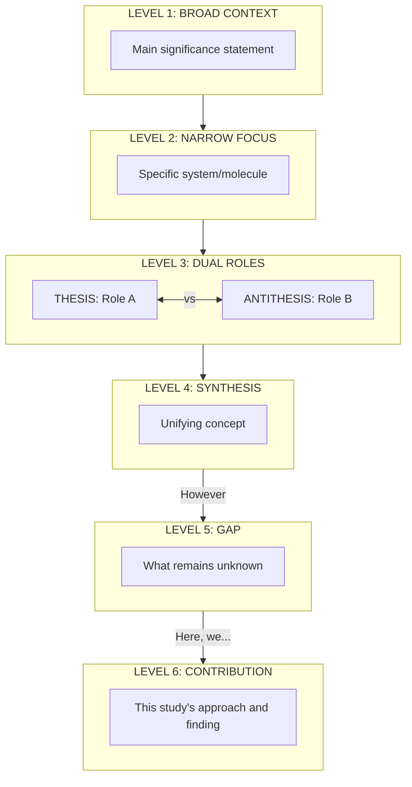

# Introduction Analysis Framework

## Purpose

This framework helps evaluate whether an introduction **serves its proper function** given the manuscript's title and abstract. A great introduction is not random background—it's a **logical argument** that justifies why the study needed to be done.

**Core Philosophy:** An introduction must build a compelling case from "why this field matters" → "what remains unknown" → "how this study fills that gap."

---

## Rhetorical Move Analysis (CARS Model Integration)

Beyond component-level analysis, this framework incorporates **sentence-level rhetorical move analysis** based on Swales' Create-a-Research-Space (CARS) model, adapted for biomedical research.

### The Three Macro-Moves

| Move | Purpose | Typical Location | Signal Words |
|------|---------|------------------|--------------|
| **MOVE 1: Establish Territory** | Claim importance, review prior work | Components 1-3 | "is essential," "plays a critical role," "has been shown to" |
| **MOVE 2: Establish Niche** | Indicate gap, raise questions, counter-claim | Component 4 | "However," "remains unclear," "has not been tested," "Conversely" |
| **MOVE 3: Occupy Niche** | Announce present research, outline purpose | Components 5-6 | "Here we," "In this study," "We demonstrate that" |

### Sentence-Level Function Taxonomy

When analyzing introductions, identify the **rhetorical function** of each sentence:

| Function | Description | Example Markers |
|----------|-------------|-----------------|
| **Hook** | Establish broad significance | "X is essential for," "plays a critical role in" |
| **Specification** | Narrow from general to specific | "Among these," "Within this context," "Specifically" |
| **Citation Claim** | Report what others found | "Previous studies showed," "It has been demonstrated that" |
| **Paradigm Statement** | Establish the ruling theory/assumption | "The prevailing model suggests," "It is generally assumed" |
| **Contrast Marker** | Signal opposing information | "Conversely," "In contrast," "However" |
| **Gap Declaration** | Explicitly state what's unknown | "remains unclear," "has not been identified," "is unknown" |
| **Pivot** | Transition from gap to solution | "Recently," "To address this," "Here" |
| **Contribution Statement** | State what this study does | "Here we show," "We demonstrate that," "This study reveals" |

### Transition Word Taxonomy with Rhetorical Purpose

| Transition | Rhetorical Purpose | Example Usage |
|------------|-------------------|---------------|
| **"Conversely"** | Antithesis introduction | Introduces opposing role/function |
| **"However"** | Gap pivot (CRITICAL) | Signals the knowledge void |
| **"Although/While"** | Concession before gap | Acknowledges progress before stating limitation |
| **"Recently"** | Methodological context | Introduces new tools/approaches |
| **"yet"** | Limitation marker | Highlights what methods cannot do |
| **"Here, we..."** | Niche occupation | Announces this study's contribution |
| **"These divergent..."** | Synthesis marker | Reconciles opposing ideas into unifying concept |

---

## Dialectical Pattern Recognition

Many high-impact introductions follow a **dialectical structure** (Thesis → Antithesis → Synthesis). Recognizing this pattern reveals the deeper argumentative logic.

### Pattern Types

**Pattern 1: Thesis-Antithesis-Synthesis (Contrast Resolution)**
```
┌─────────────────────────────────────────────────────────────────┐
│  THESIS: "X does harmful things"                                 │
│  ► Evidence for harmful role                                    │
└─────────────────────────────────────────────────────────────────┘
                              ⟷ vs ⟷
┌─────────────────────────────────────────────────────────────────┐
│  ANTITHESIS: "X also does helpful things"                        │
│  ► Evidence for beneficial role ("Conversely...")               │
└─────────────────────────────────────────────────────────────────┘
                                │
                                ▼
┌─────────────────────────────────────────────────────────────────┐
│  SYNTHESIS: "X is plastic/context-dependent"                     │
│  ► Unifying concept that reconciles both ("These divergent...")  │
└─────────────────────────────────────────────────────────────────┘
                                │
                                ▼
┌─────────────────────────────────────────────────────────────────┐
│  GAP: "What controls the switch?"                                │
│  ► The unknown regulatory mechanism ("However...")              │
└─────────────────────────────────────────────────────────────────┘
```

**Pattern 2: Paradigm-Challenge (Rule Breaking)**
```
┌─────────────────────────────────────────────────────────────────┐
│  PARADIGM: "The textbook says X works by Y"                      │
│  ► The ruling dogma/established model                           │
└─────────────────────────────────────────────────────────────────┘
                                │
                                ▼
┌─────────────────────────────────────────────────────────────────┐
│  ANOMALY: "But observation Z contradicts Y"                      │
│  ► The paradox or unexplained finding                           │
└─────────────────────────────────────────────────────────────────┘
                                │
                                ▼
┌─────────────────────────────────────────────────────────────────┐
│  GAP: "How does X actually work?"                                │
│  ► The need for revised understanding                           │
└─────────────────────────────────────────────────────────────────┘
```

**Pattern 3: Methodological Limitation-Solution**
```
┌─────────────────────────────────────────────────────────────────┐
│  METHOD A: "Standard approaches work for context X"              │
│  ► Prior success with existing tools                            │
└─────────────────────────────────────────────────────────────────┘
                                │
                                ▼
┌─────────────────────────────────────────────────────────────────┐
│  LIMITATION: "Method A fails for context Y"                      │
│  ► What current tools cannot address ("yet...")                 │
└─────────────────────────────────────────────────────────────────┘
                                │
                                ▼
┌─────────────────────────────────────────────────────────────────┐
│  NEW METHOD: "We developed approach B for context Y"             │
│  ► Methodological innovation ("Here, we established...")        │
└─────────────────────────────────────────────────────────────────┘
```

### Relationship Markers

When mapping idea relationships, use these symbols:

| Symbol | Meaning |
|--------|---------|
| → | Logical progression (leads to) |
| ⟷ | Contrast/opposition (versus) |
| ↓ | Consequence/implication (therefore) |
| ⊂ | Specification (narrowing from general to specific) |
| ∴ | Synthesis (reconciliation of opposing ideas) |

---

## The Introduction's True Purpose

An introduction serves **three interconnected purposes**:

### 1. Establish Significance

- Why does this research area matter to science/society/medicine?
- What are the stakes if this problem remains unsolved?
- Who cares about this question and why?

### 2. Identify the Knowledge Gap

- What do we currently know about this problem?
- What critical questions remain unanswered?
- Why can't existing approaches/knowledge resolve this gap?

### 3. Position the Study's Contribution

- How does THIS specific study address the gap?
- What unique approach/insight/technology does it bring?
- Why is this the right way to tackle the problem?

**Critical Insight:** The introduction is **NOT** a literature review. It's a **carefully constructed argument** that leads the reader to conclude: "This study HAD to be done."

---

## The 6-Component Structure

Based on analysis of CNS-level papers, a well-structured introduction follows this progression (often resembling a funnel):

1.  **Broad Context (The Hook)**
2.  **Narrowing (The Lens)**
3.  **The Theoretical Anchor (The Paradigm)**
4.  **The Active Tension (The Paradox/Problem)**
5.  **The Methodological Bridge (Optional - The Tool)**
6.  **The Exit Strategy (The Contribution/Investigation)**

### Nuances & Variations

- **The Recursive Gap:** The "Gap" often appears twice. First as a broad mystery in the opening ("Mechanisms of X remain unclear"), then refined to a specific molecular question after the background ("Specifically, the role of protein Y in X is unknown").
- **The Model Justification:** In mechanistic papers (especially Neuroscience/Development), authors often justify _why_ a specific model system (e.g., optic nerve, Drosophila) is ideal for solving the gap _before_ stating the contribution.
- **The "Extension" Logic:** For clinical or follow-up studies, the gap may be framed as a limitation of previous work: "We previously showed X in a small cohort, but its generalizability to Y remains unknown."

---

### Component 1: Broad Context & Significance (1-2 paragraphs)

**Purpose:** Hook the reader by establishing why anyone should care about this research area.

**What it includes:**

- The broad biological/medical/scientific problem
- Why it matters (disease burden, fundamental biology, therapeutic potential)
- The general importance to the field

**Example from "T cell costimulatory receptor CD28..." (Science):**

> "T cells become activated through a combination of antigen-specific signals from the TCR and antigen-independent signals from cosignaling receptors. Two sets of cosignaling receptors are expressed on the T cell surface: costimulatory receptors, which deliver positive signals that are essential for full activation of naïve T cells, and coinhibitory receptors, which decrease the strength of T cell signaling. The coinhibitory receptors serve as checkpoints against unrestrained T cell activation and play an important role in maintaining peripheral tolerance and immune homeostasis during infection."

**Why this works:** Establishes the fundamental biology (T cell activation), clinical relevance (immune homeostasis), and sets up the specific focus (coinhibitory receptors).

---

### Component 2: Narrow to Specific Problem (1 paragraph)

**Purpose:** Zoom from the broad field to the specific molecule/pathway/question your study addresses.

**What it includes:**

- Introduction of the specific system/molecule being studied
- Its known function or clinical relevance
- Why this particular target is important

**Example from "Anti-TIGIT antibody improves PD-L1 blockade..." (Nature):**

> "Atezolizumab is a PD-L1-targeting monoclonal antibody approved as first-line monotherapy for patients with metastatic non-small cell lung cancer (NSCLC) whose tumours have high PD-L1 expression... Tiragolumab is a monoclonal antibody that binds to TIGIT and prevents it from binding to the high-affinity ligand PVR (also known as CD155) as well as to its counter-receptor CD226. In the randomized phase 2 study CITYSCAPE, we evaluated the efficacy of first-line tiragolumab plus atezolizumab versus atezolizumab monotherapy..."

**Why this works:** Moves from general checkpoint inhibitors → specific antibodies → their clinical trial, narrowing focus progressively.

---

### Component 3: The Theoretical Anchor (The Paradigm)

**Purpose:** Establish the "Ruling Dogma" or "Landmark Theory" that the reader must know to appreciate the finding. This is not just general background; it is the specific theoretical structure that your paper will challenge, extend, or rely upon.

**What it includes:**

- The "Textbook" view of the specific system
- The dominant hypothesis (e.g., "The Slot Hypothesis")
- The standard assumption (e.g., "Sequence conservation predicts function")
- The "Known Gene" (e.g., "TP53 is the guardian of the genome")

**Example from SynGAP paper (Science) - The "Slot Hypothesis":**

> "One leading hypothesis involves the diffusional trapping of plasma membrane–inserted AMPARs by binding to proteinaceous binding 'slots' in the postsynaptic density (PSD)... According to the 'slot' hypothesis, AMPARs associate with the PSD through the binding of their auxiliary subunit transmembrane AMPAR regulating proteins (TARPs) to PDZ-domain-containing scaffolding molecules..."

**Example from Sarcoma paper (Science) - The "Epithelial Success":**

> "Genetic studies focused on common epithelial cancers have yielded major insights into the biological mechanisms underpinning specific cancer susceptibilities, exemplified by homologous recombination in breast cancer and mismatch repair in colorectal cancer."

**Why this works:** It explicitly defines the *rules of the game* (Slots, or the success of epithelial models) before introducing the player (SynGAP or Sarcoma) that breaks them.

---

### Component 4: The Active Tension (The Paradox/Gap) - THE CRITICAL PARAGRAPH

**Purpose:** Explicitly identify the conflict, paradox, or limitation in the current understanding. Move beyond "We don't know X" to "We have a problem because X contradicts Y" or "Method M fails for Case C".

**Types of Active Tension:**

1.  **The Paradox:** "X is required for Y, but X is absent in condition Z."
2.  **The Conflict:** "Model A suggests one thing, but Observation B suggests another." (e.g., Passenger vs Driver in aging).
3.  **The Limitation:** "Method A works for X, but fails for Y." (e.g., Sequence alignment fails for enhancers).
4.  **The Missing Mechanism:** "We know X happens, but we have no idea *how*."

**Example from Enhancer/ML paper (Science) - The "Sequence/Function Paradox":**

> "Widely used methods to identify conservation... measure the extent to which the nucleotides within a given region are the same across species. While these approaches have led to some exciting findings... such approaches are limited because nucleotide-level sequence conservation is not required for or always sufficient for activity conservation at enhancer orthologs."

**Example from Taurine paper (Science) - The "Passenger vs Driver Conflict":**

> "Aging-associated decline in organ functions also results from changes in the concentrations of endogenous metabolites... However, it is unclear whether these changes are passengers or drivers of aging. If a molecule in blood is a driver of aging, then a correction to its youthful levels would delay aging..."

**Why this works:** It doesn't just say "we don't know." It explains *why* the current state is problematic (Sequence fails to predict function; we don't know causality of metabolites).

---

### Component 5: The Methodological Bridge (Optional)

**Purpose:** For papers driven by new technology or a specific innovative approach, this paragraph bridges the gap between the problem and the solution.

**What it includes:**

- The introduction of a new tool (e.g., Single-cell seq, Cryo-EM, Machine Learning)
- Why this tool specifically solves the Active Tension defined above

**Example from V-ATPase paper (Science):**

> "To understand the structure and function of endogenous V-ATPase within native SV membranes, we isolated ~40-nm-diameter vesicles from rat brain using the affinity of the Legionella pneumophila effector protein SidK for the V-ATPase."

**Example from Enhancer/ML paper (Science):**

> "Leveraging that principle, we recently developed a method for identifying conservation of enhancer activity based on tissue- or cell type–specific regulatory patterns learned by machine learning models rather than conservation of nucleotides."

**Why this works:** It introduces the specific "key" (SidK, ML models) that unlocks the previously impossible task (isolating native vesicles, predicting function without sequence).

---

### Component 6: The Exit Strategy (The Contribution)

**Purpose:** State clearly what THIS study did. Choose your "Exit Mode" based on the paper type.

**Mode A: The Revelation (Standard CNS)**

- "Here we show X..."
- Focus on the *finding* / *answer*.
- Best for: Mechanistic papers, major discoveries.

**Mode B: The Investigation (Resource/Big Data)**

- "In this study, we undertook a comprehensive analysis..."
- Focus on the *scope* / *effort*.
- Best for: GWAS, Atlases, Screens (e.g., "We performed WGS on 5000 samples to...").

**Example from SynGAP paper (Science) - Mode A (Revelation):**

> "Here, we tested the role of SynGAP at PSD... We provide evidence for a distinct structural role for SynGAP in the PSD that is independent of its role as a regulator of G protein signaling..."

**Example from Sarcoma GWAS (Science) - Mode B (Investigation):**

> "In this study, we undertook a comprehensive, population-based, case-control study using WGS to identify penetrant genes and pathways that may explain sarcoma risk."

**Why this works:** The SynGAP paper sells the *finding* (structural role). The Sarcoma paper sells the *dataset/effort* (comprehensive WGS), implying the findings follow from the scale.

## Title-Abstract-Introduction Coherence

A manuscript tells ONE coherent story across these three elements:

### The Relationship

| Element          | Function                                                 | Example (cGAS paper)                                                                                                                                                              |
| ---------------- | -------------------------------------------------------- | --------------------------------------------------------------------------------------------------------------------------------------------------------------------------------- |
| **Title**        | Announces the discovery                                  | "Cyclic GMP-AMP Synthase Is a Cytosolic DNA Sensor That Activates the Type I Interferon Pathway"                                                                                  |
| **Abstract**     | Summarizes what was found and how                        | "Through biochemical fractionation and quantitative mass spectrometry, we identified a cGAMP synthase (cGAS)... cGAS bound to DNA in the cytoplasm and catalyzed cGAMP synthesis" |
| **Introduction** | Explains WHY it matters and HOW it fills a knowledge gap | Problem: cytosolic DNA sensor unknown → Gap: mechanism unclear → This study: identified cGAS through biochemistry                                                                 |

### Coherence Test Questions

**1. Does the introduction explain why the title matters?**

- If title says "X regulates Y," does introduction explain why we need to know how Y is regulated?

**2. Does the introduction set up the abstract's findings?**

- If abstract reports "We found X," does introduction identify "X was unknown" as a gap?

**3. Do title and abstract deliver on introduction's promise?**

- If introduction says "mechanism remains unclear," do title/abstract resolve that mechanism?

**Example of GOOD coherence (cGAS paper):**

- **Title promise:** Identifies a cytosolic DNA sensor
- **Introduction gap:** "The sensor that detects cytosolic DNA in the interferon pathway remains elusive"
- **Abstract delivery:** "we identified a cGAMP synthase (cGAS)... [that] is a cytosolic DNA sensor"
- **Result:** Perfect alignment ✅

**Example of POOR coherence (hypothetical):**

- **Title:** "Protein X regulates cell division"
- **Introduction:** Extensively discusses cancer and therapeutic strategies
- **Abstract:** Describes basic cell biology experiments
- **Problem:** Title is about mechanism, introduction is about therapy, abstract is about basic biology. Incoherent ❌

---

## Evaluation Framework for Introduction Analysis

When a user provides title, abstract, and introduction, systematically evaluate using this framework:

### Phase 1: Identify Components

**Map the introduction to the 6-component structure:**

☐ Component 1 (Broad Context): Present? Where? Effective?
☐ Component 2 (Narrow Focus): Present? Where? Clear transition?
☐ Component 3 (Theoretical Anchor): Present? **Does it define the paradigm?**
☐ Component 4 (Active Tension): Present? **Is it a paradox or just a gap?**
☐ Component 5 (Methodological Bridge): Present? (If applicable)
☐ Component 6 (Exit Strategy): Present? Revelation or Investigation?

**If Component 4 (Tension) is missing or weak:** This is a critical failure. Flag immediately.

---

### Phase 2: Coherence Analysis

**Test Title ↔ Abstract ↔ Introduction alignment:**

1. **Does the introduction explain why the title matters?**

   - Extract the main claim from the title
   - Find where introduction establishes why this matters
   - If missing: Flag as "Introduction doesn't justify title's significance"

2. **Does the gap match the findings?**

   - Extract the gap statement from introduction
   - Extract the main findings from abstract
   - Check if findings directly address the gap
   - If mismatch: Flag as "Findings don't resolve stated gap"

3. **Is there narrative coherence?**
   - Do all three elements tell the same scientific story?
   - Is there a logical flow: Background → Gap → Resolution?
   - If incoherent: Flag as "Title/Abstract/Introduction tell different stories"

---

### Phase 3: Quality Assessment

**Evaluate each component:**

**Component 1 (Broad Context):**

- ✅ Good: Establishes significance in 1-2 paragraphs, hooks reader
- ⚠️ Weak: Too short (1 sentence) or too long (>3 paragraphs), doesn't establish stakes
- ❌ Missing: Jumps straight into technical details

**Component 2 (Narrow Focus):**

- ✅ Good: Smooth transition from broad to specific, clear focus on study system
- ⚠️ Weak: Abrupt jump without transition
- ❌ Missing: Never identifies the specific focus of this study

**Component 3 (Theoretical Anchor):**

- ✅ Good: Explicitly names the dominant theory/gene/assumption.
- ⚠️ Weak: Vague allusions ("It is thought that...").
- ❌ Missing: No baseline established.

**Component 4 (Active Tension) - MOST CRITICAL:**

- ✅ Good: Identifies a conflict, paradox, or specific limitation.
- ⚠️ Weak: Vague ("more research needed"), doesn't explain significance.
- ❌ Missing: No gap identified - paper appears unmotivated.

**Component 5 (Methodological Bridge):**

- ✅ Good: Explains why the *new* method is needed to solve the *old* problem.
- ⚠️ Weak: Mentions method without justification.
- ❌ Missing: (Acceptable if not a method-driven paper).

**Component 6 (Exit Strategy):**

- ✅ Good: Clearly states approach and how it addresses the gap. Matches paper type (Revelation vs Investigation).
- ⚠️ Weak: States what was done but doesn't connect to gap.
- ❌ Missing: Introduction ends without stating study's contribution.

---

### Phase 4: Generate Diagnostic Report

**Provide a structured assessment:**

```
INTRODUCTION ANALYSIS REPORT

STRUCTURE:
☐ Component 1 (Broad Context): [Present/Weak/Missing] - [Brief assessment]
☐ Component 2 (Narrow Focus): [Present/Weak/Missing] - [Brief assessment]
☐ Component 3 (Theoretical Anchor): [Present/Weak/Missing] - [Brief assessment]
☐ Component 4 (Active Tension): [Present/Weak/Missing] - [Brief assessment] **CRITICAL**
☐ Component 5 (Methodological Bridge): [Present/N/A]
☐ Component 6 (Exit Strategy): [Present/Weak/Missing] - [Brief assessment]

COHERENCE:
☐ Title ↔ Introduction: [Aligned/Misaligned] - [Explanation]
☐ Abstract ↔ Introduction: [Aligned/Misaligned] - [Explanation]
☐ Gap ↔ Findings: [Resolved/Unresolved] - [Explanation]

CRITICAL ISSUES:
- [List any critical failures, especially missing/weak gap]

STRENGTHS:
- [Note effective elements]

RECOMMENDATIONS:
1. [Highest priority fix]
2. [Second priority]
3. [Additional improvements]
```

---

### Phase 5: Thought-Stimulating Diagnostic Questions

Beyond structural analysis, use these provocative questions to stress-test the introduction's logical integrity. These are NOT checklists—they are thinking tools to surface hidden weaknesses.

#### Logic Stress Tests

| Question | What It Reveals | Red Flag If... |
|----------|-----------------|----------------|
| **"If you removed the middle paragraphs (C2-C3), would the gap still logically lead to the contribution?"** | Whether the background is truly necessary or just filler | The gap→contribution logic works without the middle = middle paragraphs are decoration, not argument |
| **"What would a skeptical reviewer say is the weakest logical link?"** | The most vulnerable transition in the argument chain | You can't identify one = you haven't stress-tested your own logic |
| **"Is the 'contrast' genuine or manufactured?"** | Whether the Thesis-Antithesis is a real scientific tension or artificial framing | The antithesis could be removed without losing information = manufactured contrast |
| **"Does the theoretical anchor actually need to be challenged?"** | Whether this is paradigm-shifting or incremental work | The "paradigm" is a strawman no one believes = inflated significance |
| **"Could someone in a different subfield write this same gap statement?"** | Whether the gap is specific enough | The gap is generic ("mechanisms remain unclear") = lacks specificity |

#### Narrative Integrity Tests

| Question | What It Reveals | Red Flag If... |
|----------|-----------------|----------------|
| **"If the paper found the OPPOSITE result, would this introduction still work?"** | Whether the gap is truly neutral or pre-biased | The introduction only makes sense if finding X = the gap is rigged |
| **"What question does each paragraph answer?"** | Whether every paragraph has a clear argumentative purpose | A paragraph doesn't answer any question = delete or merge it |
| **"Where is the 'However'?"** | The exact location of the pivotal gap statement | There is no clear pivot = the gap is buried or absent |
| **"Does the protagonist match the hero of the abstract?"** | Whether the focus is consistent across sections | Introduction focuses on X, but abstract concludes about Y = incoherence |

#### The "Delete Test"

For each paragraph, ask: **"If I deleted this paragraph, would the argument still hold?"**

- **YES → The paragraph is decoration.** Consider removing or compressing.
- **NO → The paragraph is load-bearing.** It must stay.

---

### Phase 6: Generate Hierarchical Idea Map

After completing structural and diagnostic analysis, generate a **visual hierarchical map** that shows how ideas are organized and flow. This format reveals the argumentative architecture at a glance.

#### Output Format Specification

```
┌─────────────────────────────────────────────────────────────────────────────────┐
│  LEVEL 1: [LABEL - e.g., DISEASE CONTEXT / BROAD SIGNIFICANCE]                   │
│  ► [Main idea: one-line summary]                                                │
│  ► [Supporting detail if needed]                                                │
└─────────────────────────────────────────────────────────────────────────────────┘
                                        │
                                        ▼  [Relationship: → narrowing / ⊂ specification]
┌─────────────────────────────────────────────────────────────────────────────────┐
│  LEVEL 2: [LABEL - e.g., KEY PLAYER / NARROW FOCUS]                              │
│  ► [Main idea]                                                                  │
└─────────────────────────────────────────────────────────────────────────────────┘
                                        │
                    ┌───────────────────┴───────────────────┐
                    ▼                                       ▼
┌─────────────────────────────────┐     ┌─────────────────────────────────────────┐
│  LEVEL 3A: [THESIS]             │ ⟷   │  LEVEL 3B: [ANTITHESIS]                 │
│  ► [First position/role]        │     │  ► [Contrasting position/role]          │
│  ► [Evidence/details]           │ vs  │  ► [Evidence/details]                   │
└─────────────────────────────────┘     └─────────────────────────────────────────┘
                    │                                       │
                    └───────────────────┬───────────────────┘
                                        ▼  [Relationship: ∴ synthesis]
┌─────────────────────────────────────────────────────────────────────────────────┐
│  LEVEL 4: [SYNTHESIS / UNIFYING CONCEPT]                                         │
│  ► [Reconciliation of opposing ideas]                                           │
└─────────────────────────────────────────────────────────────────────────────────┘
                                        │
                                        ▼  [Relationship: → "However" pivot]
┌─────────────────────────────────────────────────────────────────────────────────┐
│  LEVEL 5: [KNOWLEDGE GAP]                                                        │
│  ► [What remains unknown - THE CRITICAL PIVOT]                                  │
└─────────────────────────────────────────────────────────────────────────────────┘
                                        │
                                        ▼  [Relationship: → "Here, we..." resolution]
┌─────────────────────────────────────────────────────────────────────────────────┐
│  LEVEL 6: [THIS STUDY'S CONTRIBUTION]                                            │
│  ► [Approach/method]                                                            │
│  ► [Main finding/contribution]                                                  │
└─────────────────────────────────────────────────────────────────────────────────┘
```

#### Relationship Annotation Key

| Arrow/Symbol | Meaning | Use When |
|--------------|---------|----------|
| `│` then `▼` | Sequential progression | Ideas flow linearly |
| `⟷` with `vs` | Contrast/opposition | Thesis vs Antithesis |
| `┬` branching | Parallel ideas | Multiple sub-ideas at same level |
| `┴` merging | Synthesis/convergence | Multiple ideas unify |
| `[→ narrowing]` | Specification annotation | Broad to specific transition |
| `[∴ synthesis]` | Resolution annotation | Contrast being reconciled |
| `["However" pivot]` | Gap marker annotation | The critical turn |

#### When to Use Each Structure

**Linear Funnel** (most common):
```
LEVEL 1 → LEVEL 2 → LEVEL 3 → GAP → CONTRIBUTION
```
Use for: Discovery papers, mechanism papers with single focus

**Dialectical Structure** (for contrast-resolution papers):
```
LEVEL 1 → LEVEL 2 → [THESIS ⟷ ANTITHESIS] → SYNTHESIS → GAP → CONTRIBUTION
```
Use for: Papers resolving paradoxes, dual-function studies

**Parallel Structure** (for multi-arm studies):
```
LEVEL 1 → [ARM A | ARM B | ARM C] → INTEGRATION → GAP → CONTRIBUTION
```
Use for: Comparative studies, multi-model papers

#### Mermaid Flowchart Alternative

For digital rendering, the same structure can be expressed as a Mermaid flowchart:



---

# PART 2: PRESCRIPTIVE GUIDANCE - Building Introduction from Title + Abstract

## Purpose of This Section

The previous sections taught you how to **EVALUATE** an existing introduction. This section teaches how to **DERIVE** what an introduction should contain when given only title and abstract.

**Use this when:**

- User provides title + abstract and asks "What should my introduction say?"
- Existing introduction is fundamentally flawed and needs restructuring
- You're helping the user write an introduction from scratch
- You need to prescribe component-by-component content

**Philosophy:** This is still diagnostic reasoning (understanding what's needed), not mechanical template filling. You're deriving content based on the LOGICAL relationship between title, abstract, and introduction.

---

## The Reverse Engineering Workflow

### Step 1: Strategic Narrative Setup (The "Argument for Necessity")

Before outlining the introduction, synthesize the "Argument for Necessity" by answering these three questions. This ensures the introduction looks _forward_ to the study, rather than just summarizing it.

- **The Target Deliverable (The 'Promise'):** What is the single most important discovery or answer this paper delivers? (This will become the climax of the Introduction).
- **The Knowledge Void (The 'Need'):** Before this study was done, what specific piece of information was missing or what problem was unsolved? (This defines the "Gap").
- **The Strategy (The 'Means'):** How did the authors attack this void? What specific approach or innovation allowed them to succeed where others hadn't? (This defines the "Contribution").

**Example (cGAS paper):**

**Title:** "Cyclic GMP-AMP Synthase Is a Cytosolic DNA Sensor That Activates the Type I Interferon Pathway"

**Strategic Narrative Setup for cGAS:**

- **The Target Deliverable (Promise):** Identification of cGAS as the elusive cytosolic enzyme that senses DNA and synthesizes cGAMP to trigger interferon.
- **The Knowledge Void (Need):** While the downstream pathway (STING) and upstream trigger (DNA) were known, the specific _sensor_ connecting them in the cytosol was unidentified.
- **The Strategy (Means):** Unbiased biochemical fractionation and quantitative mass spectrometry to purify the sensor activity from cell extracts.

---

### Step 1.5: The "Cast of Characters" Audit (Metacognitive Sort)

**Goal:** Determine the hierarchy of importance to prevent "Red Herrings" from hijacking the narrative flow.

**Diagnostic Questions (Ask yourself):**

1.  **The "Final Sentence" Test:** Look at the final sentence of the abstract (the Conclusion). Does this specific character/molecule appear there as the _driver_ or _mechanism_?

    - _Yes:_ It is a **Protagonist**. (It belongs in Component 2: Narrow Focus).
    - _No:_ It is a **Supporting Character**. (It belongs in Component 3: Current Knowledge).

2.  **The "Independence" Check:** Does the abstract state that the main finding occurs "independent of," "regardless of," or "despite" this factor?
    - _Yes:_ This factor is a **Red Herring**. It must NOT be the focus of the Narrowing paragraph (Component 2), or the reader will be misled about the paper's core message.

**Example (Gene X vs. Age):**

- **Abstract:** "Age is the predominant driver... largely independent of Gene X."
- **Audit:** Gene X is in the abstract, BUT the conclusion says the effect is _independent_ of it.
- **Decision:** Gene X is a Red Herring. The Protagonist is "Age" or "Molecular Remodeling." Gene X should be introduced later as a contextual factor, not the main lens.

**Action Rule for Component 2 (Narrow Focus):**
After completing the audit above:

- Focus Component 2 on the **Protagonist** or the **System** identified in the "Final Sentence" Test.
- **DO NOT** dedicate Component 2 to a Red Herring just because it appears in the title.
- Introduce Red Herrings/Supporting Characters in **Component 3 (Current Knowledge)** as factors that were tested or considered.

---

### Step 2: Work Backwards to Identify the Required Gap (from The Knowledge Void)

**Critical insight:** The gap statement in Component 4 MUST directly articulate the "Knowledge Void" identified in Step 1.

**Logic:**

- Your "Knowledge Void" describes the missing piece of the puzzle. The "Required Gap Statement" is the explicit phrasing of that missing piece.
- If your **Target Deliverable** is "Identification of X", the **Knowledge Void** is "X was unidentified."
- If your **Target Deliverable** is "Mechanism of Y", the **Knowledge Void** is "Mechanism of Y was unknown."

**Example derivations:**

| Knowledge Void (from Step 1)                                  | Required Gap Statement                                                       |
| ------------------------------------------------------------- | ---------------------------------------------------------------------------- |
| "The specific sensor... was unidentified"                     | "The cytosolic DNA sensor remained elusive"                                  |
| "The downstream targets of PD-1 were unknown"                 | "The downstream targets of PD-1 remained unknown"                            |
| "Whether aging affects cancer cell-intrinsically was unknown" | "Whether aging cell-intrinsically affects cancer susceptibility was unknown" |
| "The kinase responsible for activating Y was unknown"         | "Which kinase phosphorylates and activates Y remained unknown"               |

**The gap MUST directly set up your finding. If they don't match, the logic breaks.**

---

### Step 3: Work Backwards Further to Establish Why the Gap Matters

**Question to answer:** Why should anyone care that this gap exists?

**Strategies based on paper type:**

**Discovery papers (found something new):**

- Why was finding this thing important?
- What biological problem does it solve?
- What couldn't be explained before?

**Mechanism papers (how X works):**

- Why does understanding the mechanism matter?
- What therapeutic/biological implications?
- What paradoxes/observations need explanation?

**Functional papers (what X does):**

- What role was suspected but untested?
- What disease/process is affected?
- Why is this system important?

**Example (cGAS):**

- **Gap:** "Cytosolic DNA sensor unknown"
- **Why it matters:** "Cytosolic DNA triggers interferon responses critical for immunity. Without knowing the sensor, we can't understand how immune system detects pathogens or self-DNA in autoimmune diseases."

---

### Step 4: Establish Broad Context (Component 1)

**Question:** What's the biggest significance hook?

**Look for:**

- Disease burden (if clinically relevant)
- Fundamental biological importance
- Therapeutic potential
- Unsolved biological question

**Derivation strategy:**

1. Identify the BROADEST relevant field from your gap
2. State why that field matters
3. Connect to human health OR fundamental biology

**Example derivations:**

| Gap Topic                         | Broad Context                                                                                                                                                                 |
| --------------------------------- | ----------------------------------------------------------------------------------------------------------------------------------------------------------------------------- |
| "Cytosolic DNA sensor unknown"    | "Innate immunity detects pathogens through pattern recognition. DNA sensing triggers interferons critical for antiviral defense and also contributes to autoimmune diseases." |
| "PD-1 targets unknown"            | "Cancer immunotherapy blocks inhibitory checkpoints to restore T cell function. PD-1 blockade shows clinical benefit but mechanism poorly understood."                        |
| "Aging effects on cancer unclear" | "Aging is the primary risk factor for cancer, but also causes stem cell decline. This creates a paradox about how cancer incidence increases with age."                       |

**Guideline:** Component 1 should be 2-3x BROADER than your specific gap.

---

### Step 5: Build Narrow Focus (Component 2)

**Question:** How do you transition from broad context to your specific system?

**Strategy:** Identify the specific molecule/pathway/cell type your study focuses on, and explain its relevance.

**Transition pattern:**

- Broad field established (Component 1)
- "Within this field, system X is particularly important because..."
- System X becomes the focus

**Example (cGAS paper):**

- **Broad:** Innate immunity and DNA sensing
- **Narrow:** "Although TLR9 detects DNA in endosomes, cytosolic DNA sensing remained unclear"
- **Specific system:** Cytosolic DNA detection pathway

**Example (PD-1 paper):**

- **Broad:** Checkpoint blockade in cancer
- **Narrow:** "PD-1 is a coinhibitory receptor with clinical importance"
- **Specific system:** PD-1 signaling mechanism

**Metacognitive Check: The "Hero" Test**
Before writing Component 2, ask: **"If I introduce [Molecule X] here as the main lens, am I making a promise my Abstract keeps?"**

- **Scenario A:** The Abstract says "[Molecule X] drives the phenotype."
  - _Verdict:_ **Promise Kept.** Make Molecule X the focus of Component 2.
- **Scenario B:** The Abstract says "The phenotype occurs _independent_ of [Molecule X]" or "We tested [Molecule X] but found [Process Y] was the driver."
  - _Verdict:_ **False Promise.** If you focus Component 2 on Molecule X, the reader expects an X-centric paper.
  - _Correction:_ Broaden the focus of Component 2 to the **Process** or **System** (e.g., "Molecular Aging" instead of "Gene X"). Move Molecule X to **Component 3**, introducing it as a "Known Factor" or "Common Suspect" that you investigated.

**Action After Hero Test:**
Once you've identified the true "Hero" (Protagonist), proceed to write Component 2 focused on that entity/system, ensuring the introduction's promise aligns with the abstract's delivery.

---

### Step 6: Define the Theoretical Anchor (Component 3)

**Question:** What is the specific "Rule of the Game" that this paper operates within (or breaks)?

**Strategy:** Look for the "Textbook" fact or "Ruling Hypothesis" implied by the finding.

**Derivations:**

- Finding: "SynGAP competes for slots." → Anchor: "The Slot Hypothesis."
- Finding: "Enhancer sequence doesn't match function." → Anchor: "Sequence conservation is the standard proxy for function."
- Finding: "Taurine deficiency drives aging." → Anchor: "Metabolites change with age (Passenger vs Driver debate)."

---

### Step 7: Define the Active Tension (Component 4)

**Question:** Why is the current state (Component 3) insufficient or contradictory to reality?

**Strategy:** Frame the gap as a conflict.

**Derivations:**

- "Slots are limited, but SynGAP removal increases them. This contradicts the static slot model."
- "Sequence is not conserved, yet function IS conserved. This is a paradox."
- "We see metabolite changes, but don't know if they are causes or consequences."

---

### Step 8: State Study Contribution (Component 6)

**Formula:** "Here [using method], we [main finding]."

**This comes directly from your abstract:**

- Extract the main finding
- Extract the key method/approach
- State clearly with "Here we..." opening

**Structure:**

1. Signal study contribution: "Here," "Here we," "To address this," "In this study"
2. State approach: "using X," "through Y," "by combining Z"
3. Main finding: "we demonstrate/show/reveal that..."
4. Optional: Brief mechanistic insight or implication

**Example (cGAS):**

> "Through biochemical fractionation and quantitative mass spectrometry, we identified a cGAMP synthase (cGAS), which belongs to the nucleotidyltransferase family."

**Example (PD-1):**

> "We sought to identify the immediate targets of PD-1–bound phosphatase(s) through a combination of in vitro biochemical reconstitution and cell-based experiments."

---

## Worked Example: Complete Prescription

**User provides:**

**Title:** "Protein X phosphorylates Y to regulate stem cell differentiation"

**Abstract (key parts):** "Through biochemical and cellular studies, we show protein X directly phosphorylates transcription factor Y at serine 123. Phosphorylation activates Y, driving differentiation. X knockout blocks differentiation, which is rescued by phospho-mimetic Y."

**Output from Step 1: Strategic Narrative Setup (The "Argument for Necessity"):**

- **The Target Deliverable (Promise):** Demonstration that Protein X is the specific kinase that phosphorylates and activates transcription factor Y to drive differentiation.
- **The Knowledge Void (Need):** While Y was known to be essential for differentiation, the mechanism of its activation and the specific kinase responsible remained unknown.
- **The Strategy (Means):** Biochemical reconstitution and genetic rescue with phospho-mimetics to prove direct phosphorylation and functional necessity.

---

**PRESCRIBED INTRODUCTION:**

### Structural Overview

Paragraph 1 (Broad): Stem cell differentiation importance (Development/Disease)
↓
Paragraph 2 (Narrow): Transcription factor Y role
↓
Paragraph 3 (Anchor): Y is required (The "Known Hero")
↓
Paragraph 4 (Tension): How Y is activated? (The Missing Mechanism)
↓
Paragraph 5 (This Study): X phosphorylates Y to drive differentiation

### Component Content

**Component 1: Broad Context (1-2 paragraphs)**
**What to include:**

- Stem cell differentiation essential for development
- Dysregulation causes disease/cancer
- Transcriptional control is central

**Suggested content:**
"Stem cell differentiation is essential for tissue development and regeneration. Differentiation must be precisely controlled, as dysregulation contributes to developmental disorders and cancer. Transcriptional regulation is central to differentiation programs."

**Component 2: Narrow Focus (1 paragraph)**
**What to include:**

- Transcription factor Y implicated in differentiation
- Essential for lineage commitment

**Suggested content:**
"Transcription factor Y has been implicated in stem cell differentiation across multiple tissues and is essential for lineage commitment."

**Component 3: Theoretical Anchor (1-2 paragraphs)**
**What to include:**

- The "Rule": Y is a master regulator.
- Evidence: Y deletion blocks differentiation.
- The Assumption: Post-translational modification likely regulates it.

**Suggested content:**
"Previous studies showed Y expression correlates with differentiation, and Y deletion blocks differentiation. These findings established Y as a master regulator. It is generally assumed that transcription factors of this class are regulated by post-translational modifications to time their activity."

**Component 4: Active Tension (1 paragraph)**
**What to include:**

- The Gap: Which kinase?
- The Conflict: We know Y works, but we don't know *how* it gets turned on.

**Suggested content:**
"However, the specific mechanism of Y activation remained unknown. Despite its importance, the kinase responsible for phosphorylating Y to trigger the differentiation program has not been identified."

**Component 5: Study Contribution (1 paragraph)**
**What to include:**

- "Here we..."
- Approach: Biochemical/rescue
- Finding: X phosphorylates Y

**Suggested content:**
"Here, through biochemical reconstitution and genetic rescue experiments, we demonstrate that protein X directly phosphorylates Y at serine 123, activating its transcriptional function and driving stem cell differentiation."

### Compiled Example

Stem cell differentiation is essential for tissue development and regeneration. Differentiation must be precisely controlled, as dysregulation contributes to developmental disorders and cancer. Transcriptional regulation is central to differentiation programs.

Transcription factor Y has been implicated in stem cell differentiation across multiple tissues and is essential for lineage commitment.

Previous studies showed Y expression correlates with differentiation, and Y deletion blocks differentiation. These findings established Y as a master regulator. It is generally assumed that transcription factors of this class are regulated by post-translational modifications to time their activity.

However, the specific mechanism of Y activation remained unknown. Despite its importance, the kinase responsible for phosphorylating Y to trigger the differentiation program has not been identified.

Here, through biochemical reconstitution and genetic rescue experiments, we demonstrate that protein X directly phosphorylates Y at serine 123, activating its transcriptional function and driving stem cell differentiation.

---

## Decision Framework: What to Prescribe

When user asks "What should my introduction include?", use this decision tree:

```
1. EXTRACT information from title + abstract
   ↓
2. IDENTIFY paper type (discovery/mechanism/functional/paradox)
   ↓
3. DERIVE required gap (inverse of main finding)
   ↓
4. WORK BACKWARDS to establish why gap matters
   ↓
5. PRESCRIBE content for each component:
   - C1: Broadest significance
   - C2: Narrow to system
   - C3: Theoretical Anchor (The Paradigm)
   - C4: Active Tension (The Paradox)
   - C5: Methodological Bridge (if needed)
   - C6: Contribution (Exit Strategy)
   ↓
6. VERIFY logical flow and coherence
```

---

## Output Requirements

**When generating a prescription, strictly follow these rules:**

1.  **NO "Why This Works":** Do not explain the reasoning behind the suggested content.
2.  **NO Checklists:** Do not include "Quality Verification Checklist" or "Logical Flow" checks in the output.
3.  **NO Meta-Commentary:** Do not include "Key Insights" or "This prescription is based on...".
4.  **Format:** Use the "Structural Overview" and "Component Content" format shown in the Worked Example.

**Required Sections (MUST ALL BE INCLUDED):**

1.  **Strategic Narrative Setup:** Show the three-question analysis from Step 1 (Promise, Need, Means).
2.  **Cast of Characters Audit:** Show the Protagonist vs Supporting Character determination from Step 1.5 (if multi-factor study).
3.  **Structural Overview:** A visual funnel (using arrows ↓).
4.  **Component Content:** Broken down by component, with "What to include" and "Suggested content".
5.  **Compiled Example:** The full text of the suggested introduction joined together as continuous prose.

**Critical Instruction:** After completing the metacognitive analysis (Steps 1-1.5), you MUST proceed to generate ALL required sections, especially the Compiled Example. The metacognitive steps are preparation FOR action, not a substitute for it.

---

## Key Principles for Prescriptive Guidance

1. **Always work backwards from findings to gap**

   - The gap must be the logical setup for what they found
   - If gap and finding aren't inverses, the logic breaks

2. **Make the gap explicit and specific**

   - Use phrases like "remains unclear," "is unknown," "has not been tested"
   - Avoid vague statements like "more research is needed"

3. **Component 1 must be broader than the gap**

   - If C1 is too narrow, you lose the significance hook
   - Aim for 2-3x broader scope than the specific gap

4. **Component 3 sets up the gap**

   - Don't just list facts; organize them to highlight what's missing
   - What's known makes what's unknown more obvious

5. **Component 6 should echo the abstract**

   - Don't invent new framing; use their own words
   - Extract main finding and key method directly

6. **Respect the argumentative structure**
   - Every component builds the case for why the study was necessary
   - The reader should think "This study HAD to be done"

---

## Final Notes on Prescriptive Use

**This prescriptive guidance is still diagnostic reasoning:**

- You're not applying templates mechanically
- You're understanding the LOGICAL relationship between title, abstract, and introduction
- You're teaching HOW to derive content, not providing fill-in-the-blank answers

**The goal:**

- Help users understand what their introduction SHOULD contain
- Based on what their title promises and abstract delivers
- Following the argumentative structure that CNS papers use
- Creating coherent narrative across all three elements

**Remember:** A great introduction justifies why the study was necessary by building a logical argument from broad significance → specific gap → how this study fills it.
---

# PART 3: VERIFICATION PROTOCOL - Web Search Validation

## Purpose

Before finalizing an Introduction (either evaluating one or prescribing one), use **web search tools** (e.g., Tavily MCP, Context-7 MCP, DeepWiki MCP) to verify that:

1. **Claimed gaps are still gaps** (not filled by recent publications)
2. **Paradigms are current** (not superseded by new models)
3. **Methodological claims are accurate** (new tools haven't emerged)
4. **Significance claims are justified** (field actually cares about this problem)

**Philosophy:** An Introduction is an argument about the current state of knowledge. If that knowledge has changed, the argument is invalid.

---

## The Verification Workflow

### Step 1: Extract Verifiable Claims

From the Introduction (existing or prescribed), extract specific claims that can be fact-checked:

| Claim Type | Example | Verification Question |
|------------|---------|----------------------|
| **Gap Claim** | "The kinase that phosphorylates Y remains unknown" | Has anyone identified this kinase recently? |
| **Paradigm Claim** | "The Slot Hypothesis is the prevailing model" | Is this still the dominant model, or has it been challenged? |
| **Significance Claim** | "X affects 5 million people worldwide" | Is this statistic current and accurate? |
| **Methodological Claim** | "No in vivo CRISPR screening has been done in this context" | Have recent papers done this? |
| **Temporal Claim** | "For the past decade, it was thought that..." | Is this timeframe accurate? |

**Output Format:**
```
VERIFIABLE CLAIMS EXTRACTED:

1. GAP: "[Exact gap statement from text]"
   → Search query: "[Formulated search query]"

2. PARADIGM: "[Exact paradigm statement]"
   → Search query: "[Formulated search query]"

3. SIGNIFICANCE: "[Exact significance claim]"
   → Search query: "[Formulated search query]"

[Continue for all claims...]
```

---

### Step 2: Formulate Search Queries

Transform each claim into an effective search query. Use these patterns:

| Claim Type | Query Pattern | Example |
|------------|---------------|---------|
| **Gap Verification** | "[molecule/process] + [mechanism/identity] + [year range]" | "kinase phosphorylates transcription factor Y 2023 2024" |
| **Paradigm Check** | "[theory name] + challenged OR revised OR updated" | "Slot Hypothesis synaptic plasticity challenged 2024" |
| **Methodology Check** | "[technique] + [context] + [year]" | "in vivo CRISPR screen macrophages neuroinflammation 2024" |
| **Significance Check** | "[disease/condition] + prevalence OR incidence + [year]" | "multiple sclerosis global prevalence 2024" |
| **Recent Review** | "[topic] + review OR perspective + [recent year]" | "macrophage polarization neuroinflammation review 2024" |

**Search Strategy:**
1. Start with broad query to assess landscape
2. Narrow to specific claims if needed
3. Include year filters (last 2-3 years) to catch recent developments
4. Search for reviews/perspectives for paradigm shifts

---

### Step 3: Execute Verification Searches

Use Tavily MCP (or equivalent) with structured queries:

```
VERIFICATION SEARCH PROTOCOL:

For each extracted claim:

1. PRIMARY SEARCH: Direct verification of the claim
   Tool: mcp_tavily_search OR mcp_tavily_search_context
   Query: [Formulated query from Step 2]
   
2. COUNTER-SEARCH: Look for contradicting evidence
   Query: "[claimed gap] + identified OR discovered OR revealed"
   
3. RECENCY CHECK: Find most recent papers on this topic
   Query: "[topic] + 2024 OR 2025 + [journal filter if relevant]"
```

---

### Step 4: Interpret Search Results

For each claim, assess the verification outcome:

| Outcome | Meaning | Action |
|---------|---------|--------|
| **✅ VERIFIED** | No contradicting evidence found; claim appears current | Proceed with claim as written |
| **⚠️ PARTIALLY OUTDATED** | Some progress made, but gap not fully closed | Refine claim to acknowledge partial progress |
| **❌ FALSIFIED** | Gap has been filled OR paradigm overturned | CRITICAL: Must revise Introduction |
| **🔄 CONTEXT CHANGED** | New methodology or model changes framing | Consider updating framing |
| **❓ UNCERTAIN** | Insufficient search results to verify | Flag for manual literature review |

---

### Step 5: Generate Verification Report

**Output Format:**

```
┌─────────────────────────────────────────────────────────────────────────────────┐
│  INTRODUCTION VERIFICATION REPORT                                                │
│  Date: [Date]                                                                   │
│  Topic: [Brief description]                                                     │
└─────────────────────────────────────────────────────────────────────────────────┘

CLAIM 1: GAP STATEMENT
┌─────────────────────────────────────────────────────────────────────────────────┐
│  Original claim: "[Exact text from Introduction]"                                │
│  Search query: "[Query used]"                                                   │
│  Status: [✅ VERIFIED / ⚠️ PARTIALLY OUTDATED / ❌ FALSIFIED / ❓ UNCERTAIN]     │
│                                                                                 │
│  Evidence:                                                                      │
│  • [Summary of search result 1]                                                 │
│  • [Summary of search result 2]                                                 │
│                                                                                 │
│  Recommendation:                                                                │
│  [Keep as-is / Revise to: "suggested revision" / Flag for review]              │
└─────────────────────────────────────────────────────────────────────────────────┘

CLAIM 2: PARADIGM STATEMENT
┌─────────────────────────────────────────────────────────────────────────────────┐
│  [Same format as above]                                                         │
└─────────────────────────────────────────────────────────────────────────────────┘

[Continue for all claims...]

─────────────────────────────────────────────────────────────────────────────────
SUMMARY
─────────────────────────────────────────────────────────────────────────────────
Total claims verified: [N]
✅ Verified: [N]
⚠️ Needs refinement: [N]  
❌ Requires revision: [N]
❓ Uncertain (manual check needed): [N]

CRITICAL ISSUES:
• [List any falsified claims that require immediate revision]

RECOMMENDED REVISIONS:
1. [Specific revision with suggested text]
2. [...]
─────────────────────────────────────────────────────────────────────────────────
```

---

## Verification Query Templates

### For Gap Claims

**"X remains unknown/unclear/unidentified"**
```
Search queries:
1. "[X] identified OR discovered [recent year]"
2. "[X] mechanism revealed [recent year]"
3. "[Field] breakthrough [X] [recent year]"
```

**"No study has examined X in context Y"**
```
Search queries:
1. "[X] [Y] study 2023 2024 2025"
2. "[X] [Y] animal model OR clinical trial"
3. "[X] [Y] systematic review meta-analysis"
```

### For Paradigm Claims

**"The prevailing model suggests X"**
```
Search queries:
1. "[Model name] challenged OR revised 2024"
2. "[Field] paradigm shift [recent year]"
3. "[Alternative model] versus [claimed model]"
```

**"It is generally accepted that X"**
```
Search queries:
1. "[X] controversy OR debate 2024"
2. "[X] reassessed OR reevaluated"
3. "[X] evidence against"
```

### For Methodological Claims

**"Current methods cannot achieve X"**
```
Search queries:
1. "[X] new method OR technique 2024"
2. "[X] breakthrough methodology"
3. "[Limitation described] overcome OR solved"
```

**"We developed the first approach to X"**
```
Search queries:
1. "[X] method OR approach [prior years]"
2. "[X] pioneering study"
3. "[Similar approach] [same context]"
```

### For Significance Claims

**"X is a major health burden"**
```
Search queries:
1. "[Disease] prevalence incidence 2024 statistics"
2. "[Disease] global burden WHO"
3. "[Disease] economic impact healthcare costs"
```

---

## Integration with Evaluation/Prescription Workflow

### When EVALUATING an existing Introduction:

```
Phase 1-4: Standard structural analysis
     ↓
Phase 5: Thought-stimulating questions
     ↓
Phase 6: Hierarchical idea map
     ↓
>>> Phase 7: VERIFICATION PROTOCOL <<<
     ↓
Final Report: Include verification outcomes
```

### When PRESCRIBING a new Introduction:

```
Steps 1-8: Build introduction components
     ↓
>>> VERIFICATION CHECKPOINT <<<
Before generating "Compiled Example":
1. Extract gap/paradigm claims from prescribed content
2. Run verification searches
3. Revise prescribed content if needed
4. Then generate final Compiled Example
```

---

## Critical Verification Triggers

**ALWAYS run verification when:**

| Trigger | Reason |
|---------|--------|
| Gap claim uses "remains unknown" or "is not understood" | These absolute claims are easily falsified |
| Paper claims to be "first" to do something | Priority claims require careful checking |
| Paradigm is named explicitly (e.g., "Slot Hypothesis") | Named paradigms may have been challenged |
| Statistics are cited (prevalence, incidence, etc.) | Numbers become outdated |
| Claim references time ("for decades," "recently") | Temporal claims need currency check |
| Methodological innovation is claimed | New methods emerge rapidly |

---

## Example Verification Session

**Scenario:** Evaluating an Introduction about macrophage polarization in MS

**Extracted Claims:**
1. "The molecular cues that instruct macrophage transitions in vivo remain incompletely defined"
2. "Pooled CRISPR screens have not enabled screening of macrophages in an inflamed tissue environment"

**Verification Searches:**

```
CLAIM 1 VERIFICATION:

Query: "macrophage polarization molecular cues neuroinflammation identified 2023 2024"

Results:
• Paper A (Nature Immunology 2024): Identified IL-4 and IL-13 as key polarization cues
• Paper B (Cell Reports 2023): TREM2 signaling controls microglial polarization
• Review C (Immunity 2024): "Multiple cytokines now established as polarization regulators"

Assessment: ⚠️ PARTIALLY OUTDATED
Some cues identified, but "incompletely defined" may still be defensible if framed carefully.

Recommendation: Revise to "While several cytokines have been implicated, the complete set 
of molecular cues orchestrating macrophage transitions in the inflamed CNS remains undefined"
```

```
CLAIM 2 VERIFICATION:

Query: "CRISPR screen macrophages in vivo inflammation 2023 2024"

Results:
• Paper D (Science 2023): "In vivo CRISPR screen in tumor-associated macrophages"
• Paper E (Cell 2024): "Pooled CRISPR screen in microglia during neurodegeneration"

Assessment: ❌ FALSIFIED
In vivo CRISPR screens in macrophages/myeloid cells HAVE been done in inflammatory contexts.

Recommendation: CRITICAL REVISION NEEDED
Revise to: "While in vivo CRISPR screens have been applied to tumor-associated macrophages, 
this approach has not been used to systematically identify regulators of macrophage 
polarization in autoimmune neuroinflammation specifically"
```

---

## Limitations of Verification

**What verification CAN do:**
- Identify obviously outdated or falsified claims
- Find recent contradicting evidence
- Suggest needed refinements to claims
- Flag priority/novelty claims for careful checking

**What verification CANNOT do:**
- Replace comprehensive literature review
- Guarantee completeness (may miss obscure papers)
- Assess nuanced differences between similar claims
- Substitute for domain expertise

**When to escalate to manual review:**
- Search results are ambiguous or contradictory
- Highly specialized/niche claims
- Claims about unpublished or preprint work
- Statistical claims requiring primary source verification
