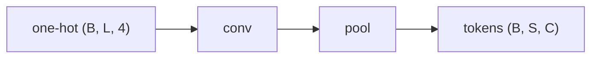

# Component test page

This page exercises every construct the chapters use. It is not part of the book.

This chapter covers

- Reading the whole-model map with a highlighted part
- Predicting a shape before seeing it, with `(B, L, 4)` chips in prose
- Listings with numbered notes, math, figures and a widget

## The map

```mermaid
flowchart LR
  N1["N1 · 1 Mb one-hot DNA<br/>+ organism index"]
  N2["N2 · Sequence encoder<br/>conv, 1 bp → 128 bp"]
  N3["N3 · Transformer tower<br/>9 blocks, MQA + RoPE"]
  N4["N4 · Pair representation<br/>2,048 bp × 2,048 bp bins"]
  N5["N5 · Sequence decoder<br/>U-Net up, 128 bp → 1 bp"]
  N6["N6 · Output embeddings<br/>1 bp | 128 bp | pair"]
  N7["N7 · Heads<br/>tracks · splicing · contacts"]
  N8["N8 · Target scaling + losses"]
  N9["N9 · Training regime<br/>pretrain → distill"]
  N10["N10 · Data<br/>TFRecord bundles, folds"]
  N11["N11 · Evaluation +<br/>variant scoring"]
  N1 -- "is downsampled by" --> N2
  N2 -- "feeds 128 bp tokens to" --> N3
  N3 -- "creates and updates" --> N4
  N4 -- "biases attention logits of" --> N3
  N2 -- "supplies U-Net skips to" --> N5
  N3 -- "is upsampled by" --> N5
  N3 -- "is projected into" --> N6
  N4 -- "is symmetrized into" --> N6
  N5 -- "is projected into" --> N6
  N6 -- "is read out linearly by" --> N7
  N7 -- "is scored against scaled targets by" --> N8
  N10 -- "provides targets for" --> N8
  N8 -- "gradients define" --> N9
  N7 -- "REF vs ALT outputs are compared by" --> N11
  style N2 fill:#E2A21B
  style N5 fill:#E2A21B
```



*Figure 0.1 The test map highlights N2 and N5, the encoder and decoder.*

A sequence tensor has shape `(B, L, 4)` and a pair tensor `(B, P, P, C)`; the symbol $x \in \mathbb{R}^{B\times L\times 4}$ is the one-hot input. A plain `code` span like `torch.nn.Conv1d` is not a shape.

> **Predict.** What is the output shape of a stride-2 pool applied to `(B, L, 128)`?
>
> <details><summary>Answer</summary>
>
> `(B, L/2, 128)`: pooling halves the length axis only, because $L_{out} = \lfloor L/2 \rfloor$.
>
> </details>

> **Note** A fact that is true but would interrupt the flow. It has `inline code` and a [link](ch1_problem_and_data.md).

> **Why is it called softmax?** Because it is a smooth version of the argmax.

> **Pitfall** Forgetting that the mask has the opposite sign convention gives silent NaNs.

> **Biology link** Position is base pairs and channel is an assay track.

> **Check yourself** What does the `N` base become after one-hot encoding?

## Listings and math

**Listing 1.1** One conv stage with its shape comments

```python
import torch
conv = torch.nn.Conv1d(4, 16, kernel_size=5, padding=2)  #1
x = torch.zeros(2, 4, 1024)             # (B, 4, L)
y = torch.nn.functional.max_pool1d(conv(x), 2)  #2
print(y.shape)                          # (B, 16, L/2)
```

#1 Same padding keeps the length at `L`.
#2 Stride-2 pooling halves it.

**Listing 1.2** The cropping rule (excerpt of `code/agdata.py`, indentation removed)

```python
lo = (len(seq) - length) // 2 + shift  #1
window = seq[lo:lo + length]           # (length, 4)
```

#1 A reading-only listing: its caption says excerpt, so it gets the "for reading" tag and is not run by `check_listings.py`.

The softmax of scores $s_i$ is

$$p_i = \frac{e^{s_i}}{\sum_j e^{s_j}} \tag{1.1}$$

Read it as: the probability of item $i$ is its score divided by the sum of all scores.

```bash
conda run -n alphagenome python ch1_data.py
```

```
(B, L, 4) --conv--> (B, L, 128) --pool--> (B, L/2, 128)
```

## Figures and diagrams




*Figure 2.2 A normal flow chart keeps its own colors from the theme.*

<!-- VISUAL-ID: example-receptive-field -->

<!-- VISUAL: an idea without a fragment stays invisible -->

A real hg38 snippet (chr1:47,215,841, TAL1 window):

```{.dna}
GAGTCCCCAATCCTTAAGAGCCAGGCATAAGAGCTGCAGCCGCCGCTGCAGCCGTTGAGTCATCAGGGAACCTGGGGCCCTCCTATGGTATGGCCTTAATCTGTCCTGAACCTAGGATACATACAACTGTCCCAGCCATGGAAGCTCACCCCAACACAAAGAGGGGATGTCTGCTGAGG
```

| Symbol | Meaning | Paper value |
|---|---|---|
| `B` | batch size | 64 |
| `L` | input length in bp | 1,048,576 = 2^20 |

## Exercises

1. Change the kernel size to 9 and predict the receptive field after three stages. Expected observable: a number printed by the script.
2. Re-implement `max_pool1d` with a reshape and a max. **Expected observable:** the same tensor as the library call.
3. Debug the snippet where `padding` is missing. Expected observable: a shape mismatch error.

## Summary

- A stage halves the length and widens the receptive field.
